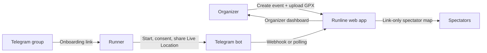

# Runline

**Live runner tracking for small running events, powered by Telegram Live Location.**


Runline lets organizers follow runners on the course map in real time, without asking anyone to install a new app. Runners share Telegram **Live Location** privately with a bot. Organizers see everyone on the GPX route from a dashboard, and spectators follow along through a read-only, link-only map.

> Runline is not an emergency, safety-monitoring, or official race-timing system. GPS accuracy and Telegram delivery can be delayed or stop entirely, and a runner can share a spoofed location. Only the latest position per runner is kept.

## Why Runline

- **No app to install.** Runners use Telegram, which they already have.
- **Consent first.** Joining a group never grants GPS access. Each runner opts in explicitly and can leave with `/stop`.
- **Privacy by default.** No location history, no replay, no Telegram IDs on public pages. Closing an event wipes saved positions.
- **Simple to host.** One Django process, SQLite, and a reverse proxy. No Redis, queues, WebSockets, or frontend build step.

## How it works



1. The organizer creates an event, sets its schedule, and uploads the GPX route.
2. The bot is added to the event's Telegram group and posts an onboarding link.
3. Each runner opens the private bot chat, agrees to the consent notice, and shares Live Location.
4. The dashboard and spectator map refresh every five seconds and label runners as waiting, live, stale, or expired.
5. Closing the event stops intake and clears all stored coordinates.

## Tech stack

| Layer | Choice |
| --- | --- |
| Backend | Django 5.2 LTS, Gunicorn |
| Database | SQLite (single instance) |
| Map | Leaflet + OpenStreetMap tiles |
| Bot | Telegram Bot API (webhook in production, long polling locally) |
| GPX parsing | `defusedxml` |
| Frontend | Server-rendered templates + vanilla JavaScript |

## Project structure

```
runlive/       Django project settings and URLs
tracking/      Events, participants, bot logic, GPX parsing, views, map assets
  bot.py         Telegram update handling (consent, location, /stop)
  gpx.py         Safe GPX route parsing
  snapshots.py   Organizer and public JSON payloads
  management/    register_webhook, check_telegram, poll_telegram
deploy/        Example Caddyfile
docs/          Design spec and implementation plan
scripts/       Local dev server wrapper
```

## Features

- Event lifecycle: draft → open → closed. Closing clears saved runner positions and cannot be undone.
- Event schedule with local start and end times, shown on the organizer list and public map.
- One Telegram group configured in Django Admin and reused by new events.
- Runner onboarding through a private Telegram chat. Joining the group never grants GPS access.
- Explicit consent covering the public, link-only map.
- Private live-location messages update one current position per runner.
- Organizer map with route, search, runner selection, status, and last fix time.
- Link-only spectator map with no organizer controls or Telegram identifiers.
- `/stop`, group removal, event closure, finite live-location expiry, and stale-position handling.
- No location history, replay, accounts for spectators, or native app.

## Requirements

- Python 3.11+ (developed with 3.14 and Django 5.2 LTS).
- A Telegram bot token and username from [@BotFather](https://t.me/BotFather).
- The bot added to the event group as an administrator. This is required for reliable membership checks and `chat_member` updates.
- A public HTTPS URL for production. Telegram webhooks need HTTPS; local dashboard development does not.
- A GPX route with at least two points.

## Local setup

```bash
python3 -m venv .venv
. .venv/bin/activate
pip install -r requirements.txt
cp .env.example .env
# edit .env: set DJANGO_SECRET_KEY, DJANGO_DEBUG=true,
# DJANGO_TIME_ZONE, DATABASE_PATH, and optionally bot credentials
set -a; . ./.env; set +a
python manage.py migrate
python manage.py createsuperuser
python manage.py runserver
```

If `runserver` stalls before "Starting development server" on macOS, use the local wrapper:

```bash
python scripts/devserver.py
```

Open http://127.0.0.1:8000/ and sign in. Without bot credentials you can create events, upload routes, and inspect the dashboard, but live Telegram ingestion will not work.

Generate a secret key with:

```bash
python -c "import secrets; print(secrets.token_urlsafe(48))"
```

## Telegram setup

1. Create the bot with BotFather and put its token and username in `.env`.
2. Add the bot to the Telegram group **as an administrator**.
3. In the group, send `/groupid`. Copy the negative ID into **Admin → Telegram settings**. New events reuse this group; the event form no longer asks for it.
4. Create an event with start and end times and upload a GPX file.
5. Open the event. The app verifies that the chat is a group and that the bot is an administrator before changing the event to open.
6. Post the runner onboarding link in the group, or let the bot welcome new members with it.
7. A runner opens the link, presses Start, reads the consent notice, and taps **Agree and share**. The runner then opens Telegram's attachment menu → Location → **Share Live Location**. A one-time pin is not tracked.
8. Share the separate spectator link with viewers. It is a bearer capability: anyone with it can view and copy visible positions. Rotate it if it leaks.

The bot cannot start a private conversation with a runner. The runner must press Start from the onboarding link. Joining a group cannot automatically enable GPS sharing.

Event schedule times use `DJANGO_TIME_ZONE` (default `Asia/Jakarta`). The schedule is displayed and validated, but opening and closing the event remain manual; there is no automatic start/end job.

Register the webhook after the public HTTPS deployment is reachable:

```bash
python manage.py register_webhook
python manage.py check_telegram
```

For local testing without a public HTTPS URL, use long polling instead of a webhook:

```bash
python manage.py poll_telegram
```

Polling and a webhook cannot run at the same time. The polling command refuses to start if a webhook is registered. Production should use the webhook; polling is only for local development.

`register_webhook` uses `PUBLIC_BASE_URL`, requires HTTPS, registers a secret header, and enables `message`, `edited_message`, `callback_query`, and `chat_member` updates. It does not drop pending updates. Never register a dummy or local webhook against a real bot.

## Production

Use one Django instance with SQLite on a persistent local volume. For this scale, run one Gunicorn worker with threads and put it behind an HTTPS reverse proxy:

```bash
python manage.py collectstatic --noinput
python manage.py migrate
python manage.py check --deploy
gunicorn runlive.wsgi:application \
  --bind 127.0.0.1:8001 \
  --workers 1 \
  --threads 8 \
  --timeout 60
```

The `deploy/Caddyfile` is a starting point. Replace the hostname and paths. It serves collected static files and disables URL access logging so capability-token paths do not end up in logs. If you enable logging, redact `/e/<token>/` paths before storing them.

Required production environment:

- `DJANGO_DEBUG=false`
- `DJANGO_SECRET_KEY` — long random value, server-side only
- `DJANGO_TIME_ZONE` — local event timezone, for example `Asia/Jakarta`
- `DJANGO_ALLOWED_HOSTS` — exact hostnames
- `DJANGO_CSRF_TRUSTED_ORIGINS` — full HTTPS origins
- `DATABASE_PATH` — path on persistent storage, outside the static root
- `PUBLIC_BASE_URL` — HTTPS origin used for the webhook
- `TELEGRAM_BOT_TOKEN`, `TELEGRAM_BOT_USERNAME`, `TELEGRAM_WEBHOOK_SECRET`

The webhook secret may use only `A-Z`, `a-z`, `0-9`, `_`, and `-`. Use HTTPS, secure cookies, explicit hosts, and a reverse proxy you control. Do not expose SQLite, `.env`, source code, or uploaded routes as static files. Run the service under a dedicated operating-system user and restrict the database and `.env` to that user. Use a server clock synchronized over NTP; location freshness depends on it.

SQLite has no row-level locking and limited write concurrency. Keep one worker, use the configured 20-second timeout and immediate transactions, and keep writes short. Move to PostgreSQL and more workers if measured contention or spectator traffic demands it. Standard OpenStreetMap tiles have no SLA and prohibit bulk/offline downloading; use another tile provider for a high-traffic public event and keep attribution visible.

### Backups and deletion

Closing an event, `/stop`, or group removal clears coordinates in the application database. It does not delete the runner's Telegram messages, copies already viewed or screenshotted by spectators, or coordinates retained in old database backups. Treat backups as sensitive location data and expire them on a stated schedule. Disclose backup retention to organizers and runners; do not promise deletion from backups unless you actually expire them.

## Verification

Run the automated suite without Telegram credentials:

```bash
DJANGO_SECRET_KEY=test-only-secret \
DJANGO_DEBUG=true \
DJANGO_TIME_ZONE=Asia/Jakarta \
DJANGO_ALLOWED_HOSTS=testserver,localhost,127.0.0.1 \
python manage.py test -v 2
```

Then use two real phones for the device checklist:

- New member sees the welcome and onboarding link.
- A non-member is refused.
- Runner consents, shares Live Location while moving, and appears on the map.
- Locking the phone, losing connectivity, and background restrictions behave as Telegram allows; report observed behavior rather than promising continuous delivery.
- `/stop` in the private bot chat removes the runner and delayed location edits do not revive them.
- Group removal and event closure remove positions from both organizer and spectator maps.
- Rotating the spectator link makes old links fail.
- A stale runner is labeled stale, not live.

The dashboard polls every five seconds. That is not a guarantee that GPS or Telegram updates arrive every five seconds. A connection indicator describes the browser-to-dashboard connection only, not Telegram or GPS health.
