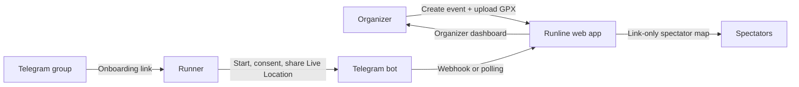

# Runline

**Live runner tracking for small running events, powered by Telegram Live Location.**


Runline lets organizers follow runners on the course map in real time, without asking anyone to install a new app. Runners share Telegram **Live Location** privately with a bot. Organizers see everyone on the GPX route from a dashboard, and spectators follow along through a read-only, link-only map.

> Runline is not an emergency, safety-monitoring, or official race-timing system. GPS accuracy and Telegram delivery can be delayed or stop entirely, and a runner can share a spoofed location. Live pages show only the latest position per runner. Recorded tracks are private to each runner and deleted 30 days after the event closes.

## Why Runline

- **No app to install.** Runners use Telegram, which they already have.
- **Consent first.** Joining a group never grants GPS access. Each runner opts in explicitly and can leave with `/stop`.
- **Privacy by default.** No public location history, replay, or Telegram IDs. Each runner can review only their own recorded track. Closing clears live positions, and tracks auto-delete 30 days later.
- **Simple to host.** One Django process, SQLite, and a reverse proxy. No Redis, queues, WebSockets, or frontend build step.

## How it works



1. The organizer creates an event, sets its schedule, and uploads the GPX route.
2. The bot is added to the event's Telegram group and posts an onboarding link.
3. Each runner opens the private bot chat, agrees to the consent notice, and shares Live Location.
4. The dashboard and spectator map refresh every five seconds and label runners as waiting, live, stale, or expired.
5. Closing the event stops intake and clears live positions. Each runner can then review their recorded track until it is deleted 30 days after close.

## Tech stack

| Layer | Choice |
| --- | --- |
| Backend | Django 5.2 LTS, Gunicorn |
| Database | SQLite (single instance) |
| Map | Leaflet + OpenStreetMap tiles |
| Bot | Telegram Bot API (webhook in production, long polling locally) |
| GPX parsing | `defusedxml` |
| Frontend | Server-rendered templates + vanilla JavaScript |

## Project structure

```
runlive/       Django project settings and URLs
tracking/      Events, participants, bot logic, GPX parsing, views, map assets
  bot.py         Telegram update handling (consent, location, /stop)
  gpx.py         Safe GPX route parsing
  snapshots.py   Organizer and public JSON payloads
  management/    register_webhook, check_telegram, poll_telegram, run_event_schedule, purge_track_points
deploy/        Example Caddyfile
docs/          Design spec and implementation plan
scripts/       Local dev server wrapper
```

## Features

- Event lifecycle: draft → open → closed. Closing clears live runner positions and cannot be undone.
- Runner-only track review: recorded positions are kept for 30 days after close, then deleted by a scheduled cleanup command.
- Recurring event creation: daily, weekly, every 2 weeks, or monthly. The app creates a bounded series of draft events with the same route.
- Closed events can be started again as a new draft with a new date. The original event, runner history, and laps stay unchanged.
- Event schedule with local start and end times, shown on the organizer list and public map.
- One Telegram group configured in Django Admin and reused by new events.
- Runner onboarding through a private Telegram chat. Joining the group never grants GPS access.
- Runner web accounts can join an event from a shared sign-up page before it opens (shown as "Registration open" once someone signs up), view the route and other registered runners while waiting, keep past events, and see elapsed time and their own lap count.
- Organizers can post the event sign-up link to the Telegram group from the event Info panel.
- Organizer lap counter for each tracked runner.
- Explicit consent covering the public, link-only map.
- Private live-location messages update one current position per runner.
- Organizer map with route, search, runner selection, status, and last fix time.
- Link-only spectator map with no organizer controls or Telegram identifiers.
- `/stop`, group removal, event closure, finite live-location expiry, and stale-position handling.
- `/stop` and group removal delete a runner's recorded track immediately.
- No public location history or replay, no accounts for spectators, no native app.

## Requirements

- Python 3.11+ (developed with 3.14 and Django 5.2 LTS).
- A Telegram bot token and username from [@BotFather](https://t.me/BotFather).
- The bot added to the event group as an administrator. This is required for reliable membership checks and `chat_member` updates.
- A public HTTPS URL for production. Telegram webhooks need HTTPS; local dashboard development does not.
- A GPX route with at least two points.

## Local setup

```bash
python3 -m venv .venv
. .venv/bin/activate
pip install -r requirements.txt
cp .env.example .env
# edit .env: set DJANGO_SECRET_KEY, DJANGO_DEBUG=true,
# DJANGO_TIME_ZONE, DATABASE_PATH, and optionally bot credentials
set -a; . ./.env; set +a
python manage.py migrate
python manage.py createsuperuser
python manage.py runserver
```

If `runserver` stalls before "Starting development server" on macOS, use the local wrapper:

```bash
python scripts/devserver.py
```

Open http://127.0.0.1:8000/ and sign in. Without bot credentials you can create events, upload routes, and inspect the dashboard, but live Telegram ingestion will not work.

To auto-open and auto-close events locally, run the scheduler in a second terminal:

```bash
python manage.py run_event_schedule --loop
```

Generate a secret key with:

```bash
python -c "import secrets; print(secrets.token_urlsafe(48))"
```

## Telegram setup

1. Create the bot with BotFather and put its token and username in `.env`.
2. Add the bot to the Telegram group **as an administrator**.
3. In the group, send `/groupid`. Copy the negative ID into **Admin → Telegram settings**. New events reuse this group; the event form no longer asks for it.
4. Create an event with start and end times and upload a GPX file.
5. The event opens automatically at its start time; the app verifies the bot is a group administrator before opening it. To start early, press **Open event**; the same check runs.
6. Open the event Info panel and press **Send to Telegram**. The bot posts the runner sign-up page to the group. Existing group members can still use the Telegram onboarding link instead.
7. A new runner opens the sign-up page, creates a username and password, and confirms the event. Back on **My events**, they press **Connect Telegram**, press Start, read the consent notice, and tap **Agree and share**. The runner then opens Telegram's attachment menu → Location → **Share Live Location**. A one-time pin is not tracked.
8. Organizers select a runner in the Runners panel and press **Add lap** to record a completed lap. Laps survive event closure. Closing clears live positions; the runner's recorded track stays in their account for 30 days.
9. Share the separate spectator link with viewers. It is a bearer capability: anyone with it can view and copy visible positions. Rotate it if it leaks.

The bot cannot start a private conversation with a runner. The runner must press Start from the onboarding link. Joining a group cannot automatically enable GPS sharing.

Event schedule times use `DJANGO_TIME_ZONE` (default `Asia/Jakarta`). The scheduler closes open events at their end time, then opens due drafts at their start time. A draft whose whole window has already passed stays draft. You can still open or close early with the event buttons. Docker Compose runs the scheduler automatically; outside Docker, run `python manage.py run_event_schedule --loop` or call `python manage.py run_event_schedule` from cron.

Register the webhook after the public HTTPS deployment is reachable:

```bash
python manage.py register_webhook
python manage.py check_telegram
```

For local testing without a public HTTPS URL, use long polling instead of a webhook:

```bash
python manage.py poll_telegram
```

Polling and a webhook cannot run at the same time. The polling command refuses to start if a webhook is registered. Production should use the webhook; polling is only for local development.

`register_webhook` uses `PUBLIC_BASE_URL`, requires HTTPS, registers a secret header, and enables `message`, `edited_message`, `callback_query`, and `chat_member` updates. It does not drop pending updates. Never register a dummy or local webhook against a real bot.

## Production

Use one Django instance with SQLite on a persistent local volume. For this scale, run one Gunicorn worker with threads and put it behind an HTTPS reverse proxy:

```bash
python manage.py collectstatic --noinput
python manage.py migrate
python manage.py check --deploy
gunicorn runlive.wsgi:application \
  --bind 127.0.0.1:8001 \
  --workers 1 \
  --threads 8 \
  --timeout 60
```

Run the event scheduler as a separate long-running process (or invoke `run_event_schedule` from cron every minute):

```bash
python manage.py run_event_schedule --loop
```

The `deploy/Caddyfile` is a starting point. It takes the public origin from `PUBLIC_BASE_URL` and the app upstream from `APP_UPSTREAM` (default `127.0.0.1:8001`). It serves collected static files and disables URL access logging so capability-token paths do not end up in logs. If you enable logging, redact `/e/<token>/` paths before storing them.

Required production environment:

- `DJANGO_DEBUG=false`
- `DJANGO_SECRET_KEY` — long random value, server-side only
- `DJANGO_TIME_ZONE` — local event timezone, for example `Asia/Jakarta`
- `DJANGO_ALLOWED_HOSTS` — exact hostnames
- `DJANGO_CSRF_TRUSTED_ORIGINS` — full HTTPS origins
- `DATABASE_PATH` — path on persistent storage, outside the static root
- `PUBLIC_BASE_URL` — HTTPS origin used for the webhook
- `TELEGRAM_BOT_TOKEN`, `TELEGRAM_BOT_USERNAME`, `TELEGRAM_WEBHOOK_SECRET`

The webhook secret may use only `A-Z`, `a-z`, `0-9`, `_`, and `-`. Use HTTPS, secure cookies, explicit hosts, and a reverse proxy you control. Do not expose SQLite, `.env`, source code, or uploaded routes as static files. Run the service under a dedicated operating-system user and restrict the database and `.env` to that user. Use a server clock synchronized over NTP; location freshness depends on it.

Recorded runner tracks are retained for 30 days after event closure. Schedule the cleanup daily with cron or a systemd timer:

```bash
python manage.py purge_track_points
# Docker Compose
docker compose exec -T app python manage.py purge_track_points
```

SQLite has no row-level locking and limited write concurrency. Keep one worker, use the configured 20-second timeout and immediate transactions, and keep writes short. Move to PostgreSQL and more workers if measured contention or spectator traffic demands it. Standard OpenStreetMap tiles have no SLA and prohibit bulk/offline downloading; use another tile provider for a high-traffic public event and keep attribution visible.

### Docker Compose

`compose.yaml` runs one Gunicorn container, one scheduler container, and Caddy with automatic HTTPS. Caddy needs ports 80 and 443, and the `PUBLIC_BASE_URL` hostname must resolve to the server. Use the bare HTTPS origin, without a trailing slash or path. The app entrypoint applies migrations and collects static files before Gunicorn starts. The scheduler runs `run_event_schedule --loop`, checking every 30 seconds.

Set `DJANGO_ALLOWED_HOSTS` and `DJANGO_CSRF_TRUSTED_ORIGINS` to the public hostname, then start the stack:

```bash
cp .env.example .env
# edit .env: secret key, public origin, hosts, timezone, bot credentials
docker compose up -d --build
docker compose exec app python manage.py createsuperuser
```

After configuring the Telegram group in Django Admin:

```bash
docker compose exec app python manage.py check_telegram
docker compose exec app python manage.py register_webhook
```

SQLite data is kept in the `sqlite_data` volume. The app is limited to one container because SQLite has a single writer. Stop the app before copying `/data/db.sqlite3` for a consistent backup. `docker compose down` keeps data; `docker compose down -v` deletes the database and Caddy certificates.

### Public HTTPS without a domain

If the server has a public IPv4 address, use a `nip.io` hostname: the name embeds the IP, so no domain purchase or DNS setup is needed. Caddy obtains a Let's Encrypt certificate over HTTP-01.

For server `203.0.113.5`:

```bash
# .env
DJANGO_DEBUG=false
DJANGO_HTTPS=true
DJANGO_ALLOWED_HOSTS=203.0.113.5.nip.io
DJANGO_CSRF_TRUSTED_ORIGINS=https://203.0.113.5.nip.io
PUBLIC_BASE_URL=https://203.0.113.5.nip.io
```

Allow inbound TCP 80 and 443, do not publish port 8000, then start and register the webhook:

```bash
docker compose up -d --build
docker compose exec app python manage.py register_webhook
docker compose exec app python manage.py check_telegram
```

Open `https://203.0.113.5.nip.io/` and share the spectator link shown on the event page. Caddy stores the certificate in the `caddy_data` volume; keep that volume.

`nip.io` is a third-party DNS service, and the hostname changes if the public IP changes (re-register the webhook after a change). Use a domain you control for a long-lived deployment. If the server is behind NAT, use a tunnel instead.

### LAN-only: access by IP over HTTP

For a phone check without a domain, Caddy can serve plain HTTP on an IP. Use the exact address the phone will open as `PUBLIC_BASE_URL`:

```bash
# .env
DJANGO_DEBUG=false
DJANGO_HTTPS=false
DJANGO_ALLOWED_HOSTS=192.168.1.50
DJANGO_CSRF_TRUSTED_ORIGINS=
PUBLIC_BASE_URL=http://192.168.1.50
```

```bash
docker compose up -d --build
docker compose exec app python manage.py createsuperuser
```

Then open `http://192.168.1.50/` on a phone connected to the same network. Allow port 80 through the host firewall. `PUBLIC_BASE_URL` must match the scheme, IP, and port in the phone's URL exactly, or Caddy returns 404.

This disables HTTPS redirects and secure cookies, so login credentials and capability links are sent unencrypted. Use it only on a trusted network. On a public server, terminate TLS with a tunnel or reverse proxy instead. Telegram webhooks require HTTPS; without one, run long polling as a foreground process:

```bash
docker compose exec app python manage.py poll_telegram
```

### Backups and deletion

Closing an event clears live positions but keeps each runner's recorded track for 30 days. `/stop` and group removal delete that runner's track immediately. Deletion still does not remove the runner's Telegram messages, copies already viewed or screenshotted by spectators, or coordinates retained in old database backups. Treat backups as sensitive location data and expire them on a stated schedule. Disclose backup retention to organizers and runners; do not promise deletion from backups unless you actually expire them.

## Verification

Run the automated suite without Telegram credentials:

```bash
DJANGO_SECRET_KEY=test-only-secret \
DJANGO_DEBUG=true \
DJANGO_TIME_ZONE=Asia/Jakarta \
DJANGO_ALLOWED_HOSTS=testserver,localhost,127.0.0.1 \
python manage.py test -v 2
```

Optional UI regression checks, if Node.js is installed (not required to run the app):

```bash
node --test scripts/*.test.cjs
```

The mobile-first slate interface uses Anime.js for short state transitions and
native scrolling for the all-event carousel, with centered GPX route outlines. Reduced-motion preferences are respected;
tabs and event management do not depend on the animation CDN being available.

Then use two real phones for the device checklist:

- New member sees the welcome and onboarding link.
- A non-member is refused.
- Runner consents, shares Live Location while moving, and appears on the map.
- Locking the phone, losing connectivity, and background restrictions behave as Telegram allows; report observed behavior rather than promising continuous delivery.
- `/stop` in the private bot chat removes the runner, deletes their recorded track, and delayed location edits do not revive them.
- Group removal clears positions and the recorded track. Event closure removes live positions from both organizer and spectator maps but keeps the runner's private track.
- After closure, the runner sees **Review track**, can scrub the track, and another account cannot open it.
- Rotating the spectator link makes old links fail.
- A stale runner is labeled stale, not live.

The dashboard polls every five seconds. That is not a guarantee that GPS or Telegram updates arrive every five seconds. A connection indicator describes the browser-to-dashboard connection only, not Telegram or GPS health.
